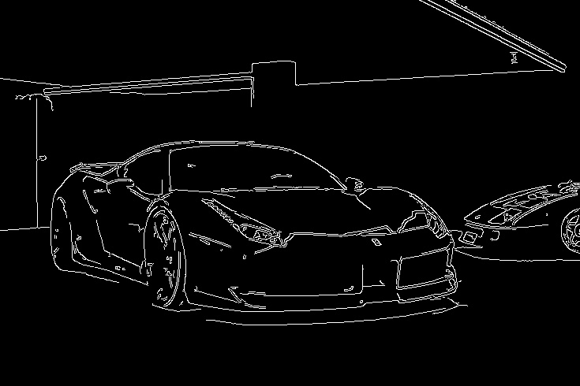
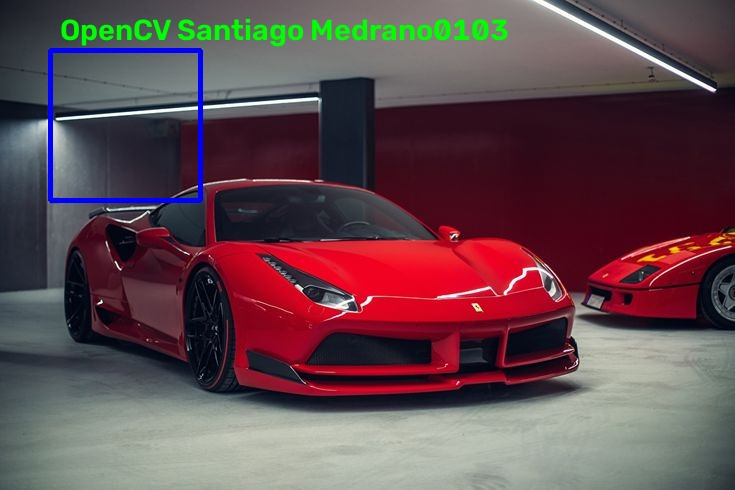
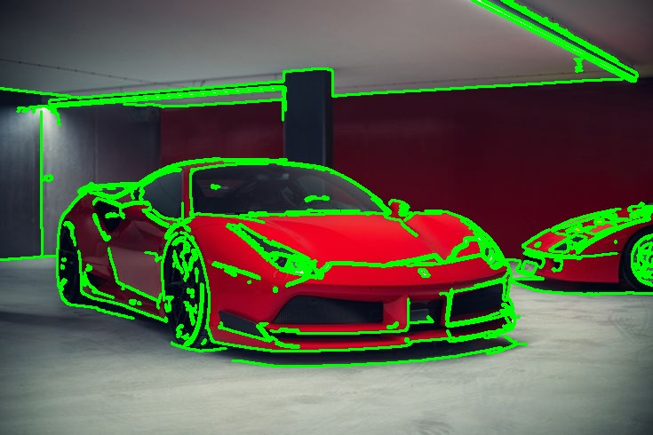

## El procesamiento de imágenes es fundamental en campos modernos como la IA, la visión artificial y la robótica. OpenCV, una potente biblioteca de código abierto, permite a los desarrolladores gestionar tareas complejas de procesamiento de imágenes con facilidad.

## imagen original

## imagen gris

## imagen redimencionada

## imagen rotada 90°

## imagen borrosa

## imagen bordes

## dibujar un rectangulo y añadir un texto

## umbralizacion

## detectar contornos y dibujarlos

